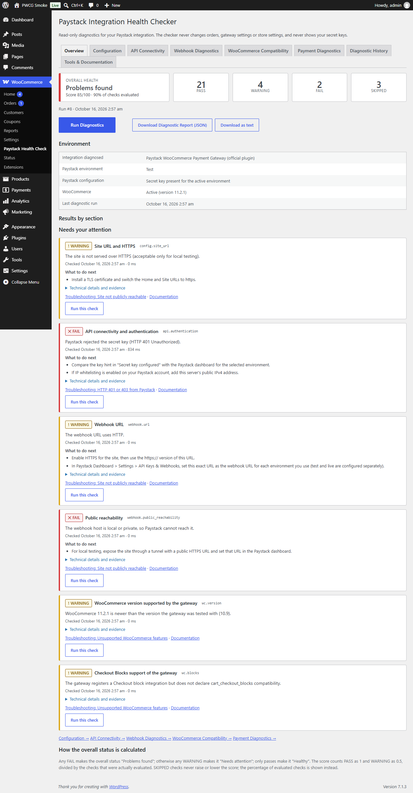
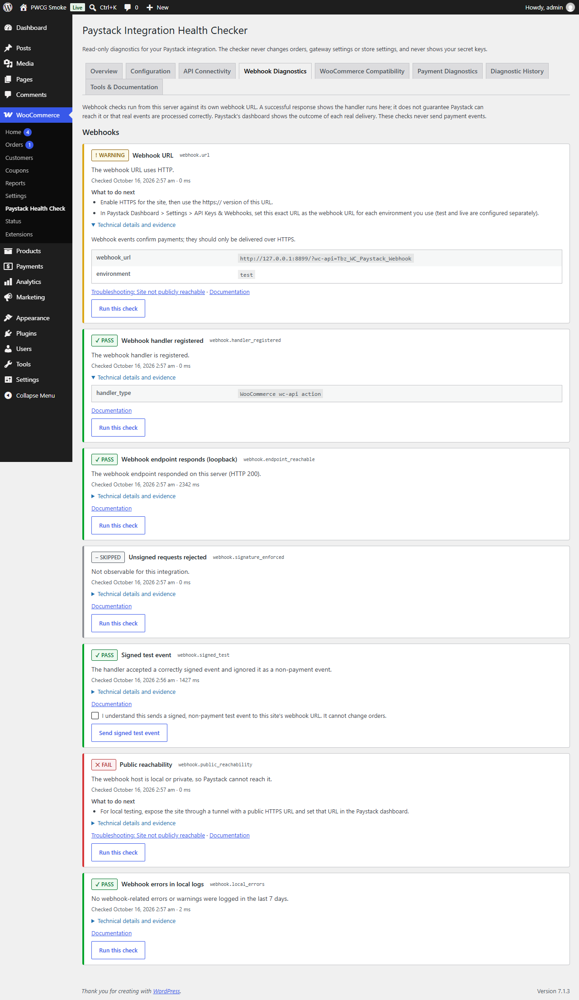
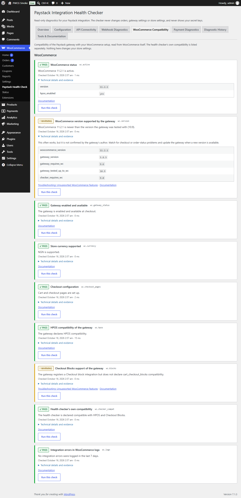
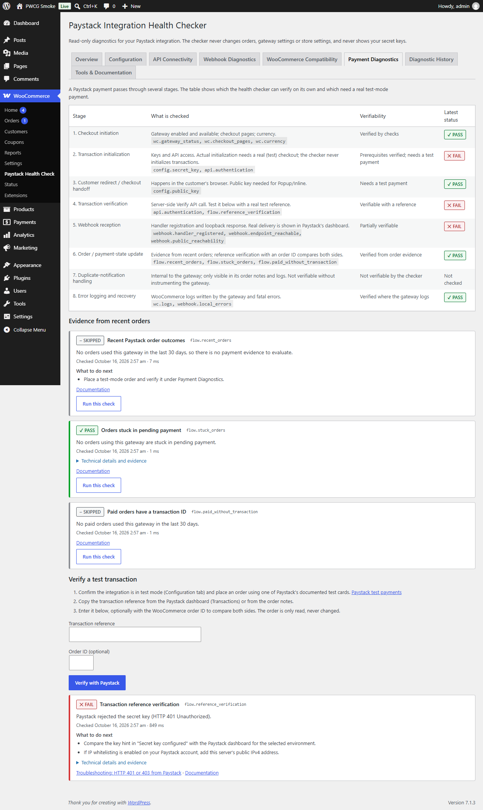
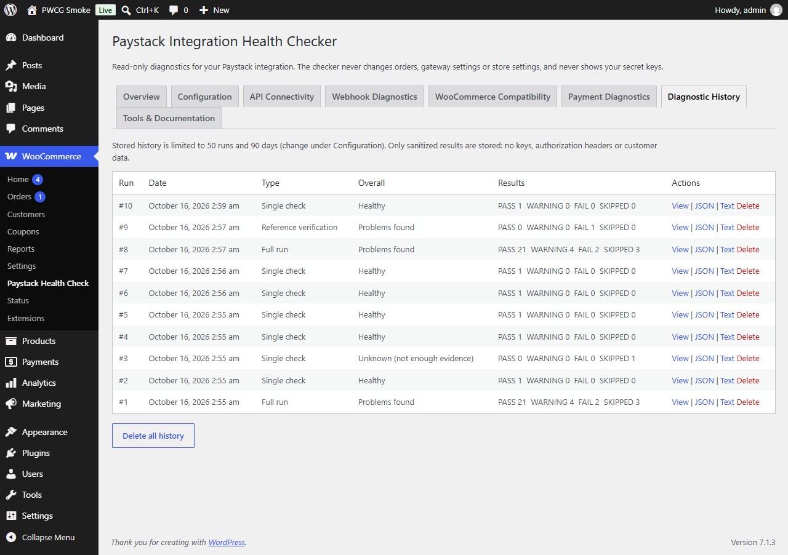
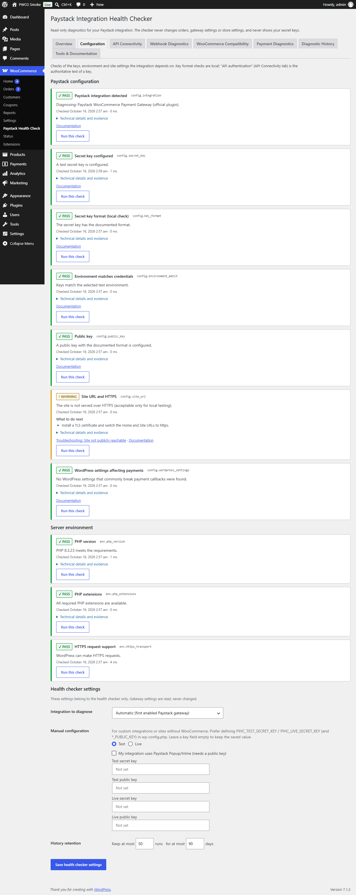

# Paystack Integration Health Checker

A WordPress plugin that systematically diagnoses Paystack payment integrations: configuration, API connectivity and authentication, webhooks, WooCommerce compatibility, and the payment flow. Every finding states its status (PASS, WARNING, FAIL or SKIPPED), the evidence behind it, and what to do next.

> **Independent project.** Not affiliated with, endorsed by, or supported by Paystack. "Paystack" names the service being diagnosed.

**Read-only by design.** The checker never creates payments, never changes orders, gateway settings or store settings, and never displays, logs or exports secret keys.

---

## Contents

1. [The problem it solves](#1-the-problem-it-solves)
2. [Features](#2-features)
3. [Screenshots](#3-screenshots)
4. [Architecture](#4-architecture)
5. [Requirements](#5-requirements)
6. [Installation](#6-installation)
7. [Configuration](#7-configuration)
8. [Running diagnostics](#8-running-diagnostics)
9. [Understanding diagnostic statuses](#9-understanding-diagnostic-statuses)
10. [Safe test-mode payment verification](#10-safe-test-mode-payment-verification)
11. [Understanding webhook checks](#11-understanding-webhook-checks)
12. [Implemented checks](#12-implemented-checks)
13. [Security model](#13-security-model)
14. [Automated testing](#14-automated-testing)
15. [Known limitations and unverified scenarios](#15-known-limitations-and-unverified-scenarios)
16. [Troubleshooting](#16-troubleshooting)
17. [Future improvements](#17-future-improvements)

---

## 1. The problem it solves

When a Paystack payment "doesn't work", the cause can sit in any of a dozen places:

- **Keys:** a key from the wrong environment, a public key pasted into a secret field, or a rotated key.
- **Network:** a firewall, DNS or TLS problem between the server and `api.paystack.co`, or IP whitelisting on the Paystack account.
- **Webhooks:** a webhook URL that is wrong, redirects, or is unreachable from the internet.
- **WooCommerce:** a gateway that is missing from the Checkout block, is incompatible with HPOS, or doesn't support the store currency.
- **Order updates:** a payment that succeeded at Paystack but never reached the order.

Merchants and support engineers usually check these by hand, one at a time. This plugin runs the checks in one place, keeps the evidence, and states clearly what it could and could not verify.

## 2. Features

- **Dashboard:**
  - overall health, a score, and PASS/WARNING/FAIL/SKIPPED counts;
  - the last run, the test or live environment (never the keys), WooCommerce status and Paystack configuration status;
  - **Run Diagnostics** and **Download Diagnostic Report** actions.
- **31 registered checks** (30 in the full run, plus the manual signed webhook test) across environment, configuration, API connectivity, webhooks, WooCommerce compatibility and payment flow, plus reference verification (see [§12](#12-implemented-checks)). Each check can also be re-run on its own.
- **A real, documented API request.** `GET /integration/payment_session_timeout` with the configured secret key confirms connectivity and authentication. It classifies DNS, TLS, timeout, connection, 401, 403, 429, 5xx, invalid-JSON and API-level failures.
- **Webhook diagnostics** that only call the site's own webhook URL. They include an explicitly confirmed, *signed* non-payment test event.
- **WooCommerce compatibility read from WooCommerce itself**: gateway HPOS and `cart_checkout_blocks` declarations, Checkout-block registration, and version ranges. The gateway's compatibility is reported separately from the checker's own.
- **Payment Diagnostics:**
  - a stage map showing what can and cannot be verified;
  - evidence from recent orders (counts only);
  - **reference verification** that compares Paystack's answer with an order, read-only.
- **Supported integrations:**
  - the official *Paystack WooCommerce Payment Gateway* (`woo-paystack`);
  - *Gateway for Paystack on WooCommerce* (`paystack-woocommerce-gateway`);
  - **manual keys** for custom integrations or sites **without WooCommerce**.
- **History** with run-to-run comparison, configurable retention, deletion, and **sanitized JSON or text reports**.
- **Troubleshooting knowledge base** with 20 topics, linked from results.

## 3. Screenshots

Captured from the actual plugin on WordPress 7.1.3 with WooCommerce 11.2.1 (headless Microsoft Edge, 2026-10-16). See [§14](#14-automated-testing) for how they were produced.

| Overview | Webhook Diagnostics |
|---|---|
|  |  |
| **WooCommerce Compatibility** | **Payment Diagnostics** |
|  |  |
| **Diagnostic History** | **Configuration** |
|  |  |

## 4. Architecture

```
paystack-integration-health-checker/
├── paystack-integration-health-checker.php   Header, constants, activation, WooCommerce feature declarations
├── uninstall.php                             Removes the checker's own settings, tables, transients, cron
├── includes/
│   ├── class-plugin.php               Composition root: builds services, registers hooks
│   ├── class-check-definition.php     Declarative check: id, name, category, callback, prerequisites, flags
│   ├── class-diagnostic-registry.php  Ordered registry; extensible via the pihc_register_checks action
│   ├── class-diagnostic-context.php   Per-run state: settings, selected integration, API factory, memo
│   ├── class-diagnostic-manager.php   Runs checks: prerequisites -> SKIPPED, error containment, redaction, storage
│   ├── class-diagnostic-result.php    Immutable result: status, summary, explanation, evidence, next steps, kb, doc, time
│   ├── class-health-summary.php       Counts, score, coverage, overall status
│   ├── class-diagnostic-history.php   Runs/results tables, trend, retention, deletion
│   ├── class-paystack-api-client.php  Read-only Paystack client (2 documented GET endpoints) + Api_Response
│   ├── class-reference-verifier.php   Payment Diagnostics: verify a reference, compare with an order
│   ├── class-report-exporter.php      Sanitized JSON / text reports
│   ├── class-redactor.php             Removes keys, tokens, e-mails, card-like numbers, sensitive keys
│   ├── class-security.php             Capability, nonces, throttling, own-site URL and private-host guards
│   ├── class-log-inspector.php        Read-only WooCommerce log scanning (file and DB handlers)
│   ├── class-troubleshooting.php      Knowledge base
│   ├── class-settings.php / class-installer.php / class-environment.php / class-autoloader.php
│   ├── integrations/                  Integration_Adapter interface; Official, Pwcg and Manual adapters; detector
│   ├── checks/                        Environment, Configuration, Connectivity, Webhook, WooCommerce, Payment_Flow
│   └── admin/                         Admin_Page (menu, settings, assets), Admin_Controller (actions), Result_Renderer
├── admin/views/ css/ js/              Templates (escaped output), styles, progressive-enhancement JS
├── bin/                               install-test-env.php, build-zip.php, lint-syntax.php
├── docs/DEVELOPER.md                  How to add a check
└── tests/                             unit/ (no WordPress), integration/ (WordPress + WooCommerce)
```

**Design principles**

- **The registry drives everything.** The dashboard, tabs, full run, history and exports all read from `Diagnostic_Registry`, so adding a check means registering it and nothing else (see [docs/DEVELOPER.md](docs/DEVELOPER.md)).
- **Adapters isolate integration specifics.** Option names, gateway IDs, webhook endpoints and log sources live in one adapter per integration. Supporting another Paystack plugin, or another provider, means adding an adapter.
- **Diagnostic logic is separate from presentation.** Checks return `Diagnostic_Result` objects and never output HTML. `Result_Renderer` renders them for both page loads and AJAX responses, so escaping lives in one place.
- **The API client doesn't depend on the admin UI.** It takes a key and a redactor and returns classified `Api_Response` objects.
- **One run, one context.** Related checks share one API probe and one loopback probe through the context memo, so a full run makes **exactly one** request to Paystack.

## 5. Requirements

| Component | Declared minimum | Actually tested |
|---|---|---|
| PHP | 7.4 | 8.3.23 runtime. PHP 7.4 syntax checked statically (PHPCompatibilityWP); not executed on 7.4. |
| WordPress | 6.5 (uses `%i` in `$wpdb->prepare`) | 7.1.3 |
| WooCommerce | Optional. 9.0+ for WooCommerce checks | 11.2.1, and without WooCommerce |
| Paystack gateways inspected | n/a | woo-paystack 5.8.5; paystack-woocommerce-gateway 1.0.0 |
| Database | MySQL/MariaDB | MariaDB (XAMPP) |
| PHP extensions | openssl, json, hash; curl recommended | All present |

Minimums below the tested versions are based on the APIs used, not on test runs.

## 6. Installation

**From the ZIP (recommended):** in WordPress go to **Plugins → Add New Plugin → Upload Plugin**, choose `paystack-integration-health-checker-1.0.0.zip`, then **Install Now** and **Activate**. Activation creates two tables and a daily retention job.

**Where to find it:**
- WooCommerce active: **WooCommerce → Paystack Health Check**
- No WooCommerce: **Tools → Paystack Health Check**

**From source:** `git clone`, then `composer build` (see [§14](#14-automated-testing)), or copy the repository into `wp-content/plugins/`.

## 7. Configuration

Usually nothing is needed. With **Integration to diagnose** set to *Automatic*, the checker picks the first enabled supported Paystack gateway, or failing that the first active one, and reads its settings **without changing them**.

Under **Configuration → Health checker settings** you can set:

- **Integration to diagnose:** Automatic, a specific gateway, or *Manual configuration*.
- **Manual configuration** (custom integrations, or no WooCommerce): environment, whether you use Paystack Popup/Inline, and keys. Prefer `wp-config.php` constants, which keep keys out of the database:
  ```php
  define( 'PIHC_TEST_SECRET_KEY', 'sk_test_...' );
  define( 'PIHC_LIVE_SECRET_KEY', 'sk_live_...' );
  define( 'PIHC_TEST_PUBLIC_KEY', 'pk_test_...' );  // only if you use Popup/Inline
  ```
  Saved keys are never printed back; the form shows a masked hint such as `sk_test_…4567`. Leave a field blank to keep the saved key, or tick *Remove saved key*.
- **History retention:** at most N runs (5–500, default 50) and D days (1–365, default 90).

When a check finds something missing, its evidence includes a link to the settings page that fixes it.

## 8. Running diagnostics

- **Run Diagnostics** (Overview) runs every check in the full suite. The result is stored as a run and summarised on the dashboard.
- **Run this check** on any card re-runs just that check. The card updates in place, and the run is stored as a "single check" run, so the dashboard summary keeps showing the last full run.
- Buttons are disabled while a request is running (no duplicate submissions), a spinner shows progress, and the outcome is announced to screen readers.
- Throttling (per user): 3 full runs per minute, 15 single checks per minute, 10 reference verifications per minute.
- Everything works without JavaScript too: forms fall back to `admin-post.php`.

## 9. Understanding diagnostic statuses

| Status | Meaning |
|---|---|
| **PASS** | The check ran and the requirement was satisfied. |
| **WARNING** | The check ran and found a **potential** problem: something that often causes failures, or evidence that is suggestive but not conclusive. |
| **FAIL** | The check ran and its evidence **confirms** a problem, e.g. Paystack answered HTTP 401 to the configured key, or the key prefix is for the other environment. |
| **SKIPPED** | The check could not be performed: a prerequisite was missing, the result isn't observable from outside, it would be unsafe, or the check hit an internal error. |

**Confirmed failure vs potential issue.** A result says FAIL only when its own evidence proves the problem. Examples:
- "The webhook URL returned HTTP 404" is a FAIL.
- "The site could not reach its own webhook URL" is only a WARNING, because many hosts block loopback requests while Paystack can still reach the site.
- "5 orders pending for over an hour" is a WARNING, because abandoned checkouts and missed webhooks look the same in order data.

When evidence can't identify a root cause, the result says so and lists the next checks to run.

**Overall status and score**
- **Problems found:** at least one FAIL. A single confirmed failure can't be averaged away by passing checks.
- **Needs attention:** no FAIL, at least one WARNING.
- **Healthy:** only PASS among the evaluated checks.
- **Unknown:** nothing could be evaluated.
- **Score** = round(100 × (PASS + 0.5 × WARNING) / evaluated). SKIPPED checks are **excluded**, so they can never inflate the score. The dashboard also shows **coverage**, the percentage of checks actually evaluated.
- A check that throws an exception or returns something invalid becomes SKIPPED ("could not be completed"), never PASS.

## 10. Safe test-mode payment verification

**Payment Diagnostics → Verify a test transaction:**

1. Make sure the gateway is in **test mode**. The page warns if it's live; verification is still read-only, but you shouldn't test with real money.
2. Place an order using one of Paystack's documented test cards (https://paystack.com/docs/payments/test-payments/).
3. Copy the transaction **reference** from the Paystack dashboard or the order notes.
4. Enter it, optionally with the **order ID**, and click **Verify with Paystack**.

The checker calls `GET /transaction/verify/:reference` with the integration's secret key and reports:

- Paystack's status (`success`, `failed`, `abandoned`, ...), amount, currency, environment (`domain`), channel and gateway response. Customer, card, authorization and IP data from the response are **discarded** before anything is shown or stored.
- With an order ID it compares both sides:
  - Paystack *success* but the order isn't paid → **FAIL** ("payment not reflected in the order");
  - amount or currency mismatch → **FAIL** (customer-borne fees are recognised when `requested_amount` equals the order total);
  - a different reference stored on the order, or an order paid with a different payment method → **WARNING**;
  - a transaction from the other environment → flagged.

**The order is never modified.** Tests assert that status, meta, notes and modification date are unchanged, and that no order hooks fire. Verification never relies on a browser redirect or a client-side message.

## 11. Understanding webhook checks

| Check | What it does | What it does **not** prove |
|---|---|---|
| Webhook URL | Generates the URL the integration expects, e.g. `/?wc-api=Tbz_WC_Paystack_Webhook` (official) or `/wp-json/pwcg/v1/webhook`; checks HTTPS | That this URL is the one configured in your Paystack dashboard (the checker can't read it) |
| Handler registered | Confirms the wc-api action or REST route exists | That the handler works |
| Endpoint responds (loopback) | **Unsigned, non-payment** POST from the server to its own URL; interprets 404/400 (no handler), 5xx (handler error), 3xx (redirect, which Paystack won't follow), 401/403 | That Paystack's servers can reach it (DNS, firewalls and CDNs differ). A GET failure would prove nothing, so POST is used. |
| Unsigned requests rejected | REST handler answering 401 = signature enforced; 2xx = **FAIL** | Not observable for the official gateway, which answers 200 either way → SKIPPED, with an explanation of what its source code does |
| Signed test event (manual, needs confirmation) | Sends `{"event":"pihc.diagnostic_ping"}` signed with HMAC-SHA512 of the raw body and the configured secret key. The official handler returns `-1` once the signature is accepted (empty body if rejected); pwcg returns 200 `unsupported_event` (401 if rejected) | Processing of real `charge.success` events. The test event is deliberately **not** a payment event, so it can't mark orders paid or trigger fulfilment. |
| Public reachability | FAIL for localhost/private/reserved hosts; WARNING if unresolvable | For public hosts → SKIPPED: verifying would mean asking a third-party service to call your site, which the checker deliberately doesn't do. Use the Paystack dashboard's webhook delivery log. |
| Webhook errors in local logs | Counts webhook/signature warnings and errors written by the gateway (pwcg logs to `pwcg-paystack`; the official gateway doesn't log, so only WooCommerce fatal errors mentioning it are checked) | Paystack-side delivery attempts. The checker has no access to Paystack's delivery logs. |

**A reachable endpoint does not guarantee successful webhook processing.** The interface says so next to these results.

## 12. Implemented checks

| ID | Name | Network | In full run |
|---|---|---|---|
| `env.php_version` | PHP version (vs plugin and gateway "Requires PHP") | – | ✓ |
| `env.php_extensions` | openssl, json, hash/SHA-512, curl | – | ✓ |
| `env.https_transport` | WordPress HTTP API can do HTTPS | – | ✓ |
| `config.integration` | Integration detected; multiple enabled Paystack gateways flagged | – | ✓ |
| `config.secret_key` | Secret key present for the active environment (masked hint) | – | ✓ |
| `config.key_format` | `sk_test_`/`sk_live_` prefix, *local check* (public key in secret field = FAIL) | – | ✓ |
| `config.environment_match` | Test mode ↔ test keys, live mode ↔ live keys (secret and public) | – | ✓ |
| `config.public_key` | Required only for Popup/Inline; secret key in a public field = FAIL (exposure) | – | ✓ |
| `config.site_url` | HTTPS (FAIL in live, WARNING in test); home/site URL host mismatch | – | ✓ |
| `config.wordpress_settings` | WP-Cron disabled, errors displayed in responses, maintenance mode | – | ✓ |
| `api.dns` | `api.paystack.co` resolves | DNS only | ✓ |
| `api.authentication` | `GET /integration/payment_session_timeout`; full error classification | Paystack | ✓ |
| `webhook.url` | Expected webhook URL, HTTPS | – | ✓ |
| `webhook.handler_registered` | wc-api action / REST route registered | – | ✓ |
| `webhook.endpoint_reachable` | Unsigned loopback POST, interpreted per integration | own site | ✓ |
| `webhook.signature_enforced` | Unsigned request rejected (where observable) | own site | ✓ |
| `webhook.signed_test` | Signed non-payment test event accepted | own site | manual only |
| `webhook.public_reachability` | Host not local/private | DNS only | ✓ |
| `webhook.local_errors` | Webhook warnings/errors in WooCommerce logs (7 days) | – | ✓ |
| `wc.active` | WooCommerce active / installed / absent | – | ✓ |
| `wc.version` | WooCommerce within the gateway's declared range | – | ✓ |
| `wc.gateway_status` | Gateway enabled **and** available at checkout | – | ✓ |
| `wc.currency` | Store currency accepted by the gateway and listed in Paystack's API docs | – | ✓ |
| `wc.checkout_pages` | Cart/checkout pages set, published, containing block or shortcode | – | ✓ |
| `wc.hpos` | Gateway's HPOS declaration as recorded by WooCommerce | – | ✓ |
| `wc.blocks` | Checkout block in use vs gateway block registration and declaration | – | ✓ |
| `wc.checker_compat` | The checker's own HPOS/Blocks declarations | – | ✓ |
| `wc.logs` | Gateway errors and fatal errors in WooCommerce logs (7 days) | – | ✓ |
| `flow.recent_orders` | This gateway's orders (30 days) by status | – | ✓ |
| `flow.stuck_orders` | Pending > 60 minutes | – | ✓ |
| `flow.paid_without_transaction` | Paid orders missing a transaction ID | – | ✓ |
| `flow.reference_verification` | Reference verification (Payment Diagnostics form) | Paystack | manual |

Real findings these checks produced against current software during development:
- woo-paystack 5.8.5 declares "WC tested up to: 10.9", so `wc.version` warns on WooCommerce 11.2.1.
- woo-paystack 5.8.5 registers Checkout block integrations but does not declare `cart_checkout_blocks`, so `wc.blocks` warns.
- It also accepts EGP and RWF, which aren't in the API documentation's currency table, so `wc.currency` warns for those.

## 13. Security model

| Concern | Control |
|---|---|
| Who can run diagnostics | `manage_woocommerce` when WooCommerce is active, otherwise `manage_options` (filter `pihc_capability`). Checked on the page **and** in every handler. |
| CSRF | A nonce per action (run, run check, verify reference, export, delete), verified before anything happens |
| Public exposure | **No REST routes and no `wp_ajax_nopriv_` handlers.** Logged-in admin requests only. |
| SSRF / arbitrary URLs | The checker never requests a URL supplied by a user. Outbound requests go only to the fixed `https://api.paystack.co` base (two GET paths) or to URLs the site generates for itself, verified by `Security::is_own_site_url()` (same host and port, no credentials, http/https only). A test runs every check and asserts that every outbound request went to one of those two hosts. |
| Secrets | Keys never rendered (masked hints only), never sent to the browser, never logged, stored or exported. The `Redactor` removes `sk_`/`pk_` tokens, bearer tokens, e-mail addresses, 13–19 digit numbers, sensitive keys, and the exact value of every key configured on the site. It is applied when results are stored **and** again on export. |
| Paystack TLS | `sslverify` stays on for API calls, as Paystack's docs require |
| Untrusted API responses | JSON decoded defensively. Only whitelisted scalar fields of a verified transaction are kept; messages are truncated and redacted. |
| Input | Check IDs must exist in the registry; references match `^[A-Za-z0-9.=-]{1,100}\z`; IDs go through `absint`; tabs are whitelisted; settings are sanitized and clamped |
| Output | All HTML escaped in templates or `Result_Renderer`; downloads are sent with `X-Content-Type-Options: nosniff` |
| SQL | Every query uses `$wpdb->prepare()` (`%i` for identifiers) or `$wpdb->insert/delete` |
| Abuse / quota | Per-user throttling (a sliding window in transients). This guards against accidents and API quota use; it is not an authorization control. |
| Destructive operations | None during diagnostics. The signed test event is non-payment, own-site only, and needs explicit confirmation. Orders are only read. |
| Data minimisation | History stores results and a non-sensitive environment snapshot (versions, booleans, site host). Retention is bounded. Uninstall removes all checker data. |

This is a portfolio project. Before relying on it in production, get an independent security review and test it on a staging copy of your site.

## 14. Automated testing

No test touches a real Paystack account. Every outbound request must be mocked, and anything unmocked fails the test (`tests/bootstrap.php`).

```bash
composer install
php bin/install-test-env.php     # WordPress 7.1.3 + WooCommerce 11.2.1 + woo-paystack 5.8.5 (+ sibling pwcg project if present)

vendor/bin/phpunit -c phpunit-unit.xml.dist                    # 26 unit tests, no WordPress
vendor/bin/phpunit                                             # unit + integration (WooCommerce, both gateways)
PIHC_TESTS_WOOCOMMERCE=0 vendor/bin/phpunit --group no-woocommerce   # only the checker loaded
vendor/bin/phpcs                                               # WordPress, WooCommerce, PHP 7.4+ standards
php bin/lint-syntax.php
composer build                                                 # dist/paystack-integration-health-checker-1.0.0.zip
```

(On Windows PowerShell: `$env:PIHC_TESTS_WOOCOMMERCE=0; vendor/bin/phpunit --group no-woocommerce`.)

| Area | Test file | Highlights |
|---|---|---|
| Pure model | `tests/unit/CoreModelTest.php` | Scoring and status rules (skipped never inflates; one FAIL can't be averaged away), redaction, transport-error classification, reference rules, field whitelisting, registry |
| Configuration | `ConfigurationChecksTest` | Missing key, key format (local), environment mismatch, public-key rules incl. secret-in-public exposure, HTTPS rules, auto-detection, two enabled gateways |
| API | `ConnectivityChecksTest` | Request shape (GET, Bearer, `sslverify`, timeout, no body); 401/403/429 (+ reset header)/5xx/timeout/DNS/TLS/refused/HTML/`status:false`/missing data; one API call per full run; never initializes transactions |
| Webhooks | `WebhookChecksTest` | Interpretation of every response class; signed event signature correctness; **SSRF guard** (foreign URL → no request); localhost detection; log excerpts redacted; **contract test against the real pwcg handler** |
| WooCommerce | `WooCommerceChecksTest` | Against the **real** woo-paystack 5.8.5 and pwcg: version range, enabled/hidden gateway, currencies, HPOS and Blocks declarations, checkout pages, logs; **no settings changed by a full run** |
| Payments | `PaymentDiagnosticsTest` | Reference verification outcomes; **order unchanged and no order hooks fired**; customer, card and authorization data never stored; order-evidence checks |
| Runner/history | `ManagerAndHistoryTest` | Error containment, prerequisites, redaction before storage, extension point, retention by count and age, trend, deletion |
| Security/export | `SecurityAndExportTest` | Reports contain versions and a skipped section but no keys or PII; all outbound hosts; URL and host guards; throttling; settings sanitization |
| Authorization | `AdminControllerTest` | Real admin-ajax: roles, missing/forged/wrong-action nonces, throttling (429), input validation, confirmation required for the signed event |
| Admin UI | `AdminPageTest` | Every tab renders without printing keys; textual statuses; capability check; menu placement |
| No WooCommerce | `NoWooCommerceTest` (group `no-woocommerce`) | Full run works, WooCommerce checks SKIPPED, manual keys enable API checks, menu under Tools |

**Results of the runs during development (2026-10-16):**
- 26 unit tests OK
- 200 full-suite tests OK, five consecutive runs
- 7 no-WooCommerce tests OK
- PHPCS: 0 errors, 0 warnings

Details are in the final implementation report.

**Installation smoke test (2026-10-16)**, on a fresh WordPress 7.1.3 site with WooCommerce 11.2.1, woo-paystack 5.8.5 and paystack-woocommerce-gateway 1.0.0, using the built ZIP and **no mocks**:

- Activation created both tables and the daily retention job; 31 checks were registered.
- A full run sent a **real** `GET /integration/payment_session_timeout` to Paystack with a deliberately fake test key. Paystack answered **HTTP 401 "Invalid key"** (871 ms), reported as FAIL with the right guidance.
- **Real loopback requests** to both webhook handlers matched the behaviour inferred from their source code:
  - official gateway: unsigned → 200 with an empty body; signed test event → 200 with body `-1` → PASS;
  - pwcg: unsigned → 401 → PASS for "Unsigned requests rejected"; signed test event → 200 `unsupported_event` → PASS.
- An existing order was unchanged afterwards.
- Real findings were reported: woo-paystack's tested-up-to WooCommerce version (10.9) and its missing `cart_checkout_blocks` declaration, an HTTP site, and a private host that can't receive webhooks.
- A headless Microsoft Edge pass checked 25 things, all passing:
  - every tab renders with no PHP errors and no key in the HTML;
  - AJAX re-run updates the card in place and announces it in the live region;
  - a double click sends only **one** request;
  - the JSON report downloads with no key, and a forged-nonce download returns 403;
  - the summary fits at 375 px;
  - no JavaScript console errors.

  The screenshots in [§3](#3-screenshots) come from that run.

**Not covered by automated tests:**
- the admin JavaScript (exercised only in the browser smoke test);
- a real delivery of a Paystack webhook;
- PHP versions other than 8.3.

## 15. Known limitations and unverified scenarios

- **No access to the Paystack dashboard:** the checker cannot read the configured webhook URL, Paystack's webhook delivery log, IP-whitelist settings, or which currencies are enabled on the account. It says so in the relevant results.
- **External reachability is not verified** for public hosts (that would need a third-party callback service, which is deliberately not used).
- **Loopback checks** prove the handler responds on this server, not that Paystack can reach it. Hosts that block loopback produce WARNINGs.
- **Official gateway signature enforcement** cannot be observed from outside (identical responses). The checker relies on the signed test event plus documented source behaviour (version 5.8.5); later versions may differ.
- **Adapter facts** come from woo-paystack 5.8.5 and pwcg 1.0.0. Option names or endpoints changed by future versions would need adapter updates.
- **HPOS and Blocks declarations** are read through WooCommerce internals (`FeaturesController`, Blocks `PaymentMethodRegistry`). They are guarded, so if a future WooCommerce changes them the checks report SKIPPED rather than crashing.
- **Payment stages not verifiable without a test payment:** transaction initialization, the customer redirect/handoff, and duplicate-notification handling inside the gateway.
- **Order evidence** cannot distinguish abandoned checkouts from paid-but-unconfirmed orders; those results are WARNINGs and point to reference verification.
- **Log inspection** covers WooCommerce's file and database handlers only, and reads the last 256 KB of each recent file.
- **Throttling** uses transients and is not atomic under heavy concurrency.
- **Not executed** on PHP 7.4–8.2, older WordPress or WooCommerce, multisite, or the SQLite drop-in.

## 16. Troubleshooting

The **Tools & Documentation** tab contains the knowledge base. Each result links to its topic: credentials, key format, environment mismatch, timeouts, DNS, TLS, 401/403 (including IP whitelisting), 429, 5xx, wrong reference, amount/currency mismatch, verification failures, missing webhooks, invalid signatures, duplicate processing, orders not updating, plugin conflicts, unsupported WooCommerce features, the PHP environment, and non-public sites.

Problems with the checker itself:
- **Every check SKIPPED:** no integration was found. Activate a supported gateway or enter keys under Configuration.
- **"Too many requests":** you hit the per-user throttle; wait the number of seconds shown.
- **Loopback warnings on every run:** your host blocks requests from the server to itself. Use Paystack's webhook delivery log instead.
- **Webhook errors in local logs:** the default window is 7 days. Old errors stop appearing once the window has passed.

## 17. Future improvements

- Optional, opt-in external reachability check through a self-hosted probe.
- More adapters (other Paystack plugins, other payment providers) through `pihc_integration_adapters`.
- Scheduled diagnostics with e-mail alerts on new FAILs.
- A JavaScript test harness for the admin UI.
- A CI matrix across PHP 7.4–8.4 and older WordPress/WooCommerce versions.
- WP-CLI command (`wp pihc run --format=json`).

---

License: GPL-2.0-or-later. See `LICENSE`.
